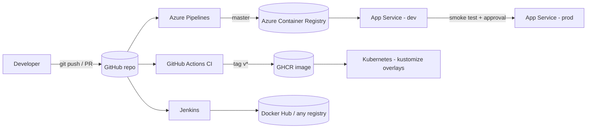

# DevOps App CI/CD

[](https://github.com/AhmedEltofany/DevOPSAPPCICD/actions/workflows/ci.yml)

A small Java web application that gives you **one codebase with every common CI/CD path built in**:
Maven, Docker, Docker Compose, Azure Pipelines, GitHub Actions, Jenkins, Kubernetes and Azure App Service (Bicep).

It started as the course project from Rahul Shetty Academy's *QA Automation + DevOps CI/CD* course and was
extended into a hands-on learning lab with real features, tests, pipelines and step-by-step tutorials.

---

## What's inside

| Area | What you get |
|---|---|
| **App** | Java 17, Jakarta Servlets on Tomcat 10.1, multi-language greeting API, health checks, build info |
| **Tests** | JUnit 5 + Mockito, parameterised tests, JaCoCo coverage report + quality gate (70% lines) |
| **Docker** | Multi-stage `Dockerfile`, `AzureDockerfile` for pre-built WARs, non-root user, `HEALTHCHECK`, Compose |
| **Azure Pipelines** | Multi-stage: build & test → image to ACR → deploy dev → deploy prod (approval), reusable template |
| **GitHub Actions** | CI on Java 17 & 21, Docker smoke test, vulnerability scan, K8s validation, tag-based releases to GHCR |
| **Jenkins** | Declarative `Jenkinsfile`: test reports, coverage, image build/push, deploy, smoke test |
| **Kubernetes** | Kustomize base + `dev`/`prod` overlays, probes, HPA, PDB, Ingress, hardened security context |
| **Azure infra** | Bicep: ACR, App Service (Linux container), managed identity, App Insights, Log Analytics |
| **Tooling** | `Makefile`, `scripts/smoke-test.sh`, Dependabot, `.editorconfig` |

## Architecture



```
.
├── server/                      # Plain Java business logic (Greeter, Language) + tests
├── webapp/                      # Servlets, JSP landing page, JSON API, health checks + tests
├── Dockerfile                   # Multi-stage: builds the code inside Docker
├── AzureDockerfile              # Packages an already-built WAR (used by CI)
├── docker-compose.yml
├── azure-pipelines.yml          # Azure DevOps multi-stage pipeline
├── .azure-pipelines/templates/  # Reusable deploy job
├── .github/workflows/           # ci.yml, release.yml
├── Jenkinsfile
├── k8s/                         # base + overlays/dev + overlays/prod
├── infra/azure/                 # main.bicep + dev/prod parameters
├── scripts/smoke-test.sh        # Post-deploy checks used by every pipeline
├── Makefile
└── docs/tutorials/              # Step-by-step guides (start here)
```

## Quick start

**Option A - Docker only** (nothing else to install):

```bash
docker compose up --build
# open http://localhost:8080/
```

**Option B - Java 17 + Maven:**

```bash
mvn verify                                   # build, test, coverage gate
mvn install -DskipTests && mvn -pl webapp jetty:run
# open http://localhost:8080/
```

Then smoke test it: `bash scripts/smoke-test.sh http://localhost:8080`

## API

| Method & path | Example response |
|---|---|
| `GET /` | Landing page with a form and links |
| `GET /hello?name=Ahmed&lang=ar` | HTML page, right-to-left for Arabic |
| `GET /api/greet?name=Ahmed&lang=fr` | `{"name":"Ahmed","language":"fr","message":"Bonjour Ahmed, comment allez-vous ?"}` |
| `GET /api/greet?lang=xx` | `400 {"error":"Unsupported language 'xx'","supportedLanguages":"en, ar, fr, es, de"}` |
| `GET /api/info` | `{"app":"devopsappcicd","version":"1.0-SNAPSHOT","commit":"3f2a1bc","environment":"dev","hostname":"pod-abc",...}` |
| `GET /health` · `/health/live` · `/health/ready` | `{"status":"UP","check":"ready","uptimeSeconds":42}` (`503` + `DOWN` when `APP_READY=false`) |

Supported languages: `en`, `ar`, `fr`, `es`, `de`.

## Tutorials

Work through them in order, or jump to the tool you need:

1. [Run and test the app locally](docs/tutorials/01-run-locally.md)
2. [Add a feature end to end (TDD)](docs/tutorials/02-add-a-feature.md)
3. [Docker and Docker Compose](docs/tutorials/03-docker.md)
4. [Azure Pipelines: multi-stage CI/CD](docs/tutorials/04-azure-pipelines.md)
5. [GitHub Actions: CI and releases](docs/tutorials/05-github-actions.md)
6. [Jenkins pipeline](docs/tutorials/06-jenkins.md)
7. [Kubernetes with Kustomize](docs/tutorials/07-kubernetes.md)
8. [Azure infrastructure with Bicep](docs/tutorials/08-azure-infra-bicep.md)
9. [Troubleshooting](docs/tutorials/09-troubleshooting.md)

## Common commands

```bash
make help            # list everything
make verify          # what CI runs
make run             # Jetty on :8080
make docker-build    # build image
make compose-up      # run with Compose
make smoke           # smoke test http://localhost:8080
make k8s-dev         # kubectl apply -k k8s/overlays/dev
```

## Upgrading from the original version

* The app now runs at `/` (deployed as `ROOT.war`) instead of `/webapp`.
* Tomcat is pinned to `10.1` (Jakarta EE) instead of `latest`; servlets use `jakarta.servlet`.
* The old root `Dockerfile` that copied `./webapp.war` from the repo root is replaced by a multi-stage build.
  If you still have a pre-built WAR, use `AzureDockerfile` (it reads `webapp/target/webapp.war`).
* `azure-pipelines.yml` builds with JDK 17. Docker/deploy stages are off until you set `enableDeploy: true`.

## License

For learning purposes. Use it freely.
