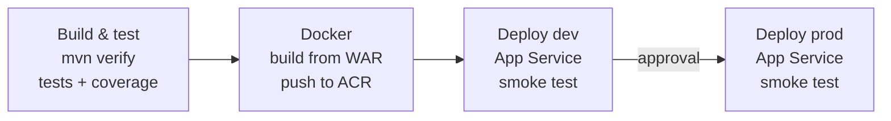

# 4. Azure Pipelines: multi-stage CI/CD

**Goal:** run `azure-pipelines.yml` in Azure DevOps, then switch on Docker, dev and prod
deployments with a manual approval gate.
**Time:** 45 minutes. **Needs:** an Azure DevOps organisation and (for Part B) an Azure subscription.

## The pipeline at a glance



| Stage | Runs on | Key ideas |
|---|---|---|
| Build & test | every push and PR | `Cache@2` for `~/.m2`, `Maven@4`, JUnit results tab, JaCoCo coverage tab, WAR published as a **pipeline artifact** |
| Docker | `master` only | Downloads the *tested* WAR - the image contains exactly what passed the tests |
| Deploy dev | after Docker | **Deployment job** + **environment** = deployment history per environment |
| Deploy prod | after dev | Same template as dev; an **approval check** on the environment pauses here |

Docker and deploy stages are wrapped in a **compile-time condition**:

```yaml
- ${{ if eq(variables.enableDeploy, 'true') }}:
```

While `enableDeploy` is `false`, those stages don't exist, so the pipeline never asks for service
connections you haven't created yet.

## Part A - Build & test only (10 minutes)

1. In Azure DevOps: **Pipelines → New pipeline → GitHub → select this repo**.
2. Choose **Existing Azure Pipelines YAML file** → `/azure-pipelines.yml` → **Run**.
3. When it finishes, open the run and look at:
   * **Tests** tab - every JUnit test, with history across runs.
   * **Code Coverage** tab - the JaCoCo report.
   * **1 published** artifact - `war/webapp.war`.

Try breaking a test on a branch and opening a PR - the `pr:` trigger validates it before merge.

## Part B - Enable Docker and deployments

### 1. Create the Azure resources

Follow [tutorial 8](08-azure-infra-bicep.md) for **dev** and **prod**. Note the outputs:
`acrLoginServer`, `webAppName` (dev) and `webAppName` (prod).

### 2. Create two service connections

**Project settings → Service connections → New service connection**

| Type | Name (must match the YAML) | Settings |
|---|---|---|
| Docker Registry → Azure Container Registry | `acr-service-connection` | pick your subscription and the ACR |
| Azure Resource Manager → Workload identity federation (automatic) | `azure-service-connection` | scope: the resource group(s) |

### 3. Create environments and the approval

**Pipelines → Environments → New environment**: `devopsappcicd-dev` and `devopsappcicd-prod`
(they are also created automatically on first run).

Open `devopsappcicd-prod` → **⋮ → Approvals and checks → Approvals** → add yourself.

### 4. Fill in the variables

```yaml
variables:
  enableDeploy: true
  dockerRegistryServiceConnection: acr-service-connection
  azureSubscription: azure-service-connection
  containerRegistry: acrdevopsappcicdxxxx.azurecr.io
  webAppNameDev: app-devopsappcicd-dev-xxxx
  webAppNameProd: app-devopsappcicd-prod-xxxx
```

Commit to `master`. The run now shows four stages. After **Deploy dev** passes its smoke test,
the run waits for your approval before production.

### 5. Verify

```bash
curl -s https://<webAppNameDev>.azurewebsites.net/api/info
```

`commit` equals the pipeline's `Build.SourceVersion` and `environment` is `dev`.
**Environments → devopsappcicd-dev** shows which run (and commit) is deployed.

## How the deploy template works

`.azure-pipelines/templates/deploy-webapp.yml` takes `environment`, `webAppName`, `image` and
`azureSubscription`. Both deploy stages call it, so dev and prod are deployed **identically** - the
only difference is the parameters. Add a `test` environment by adding one more stage that calls the
same template.

Inside it:

1. `checkout: self` - deployment jobs skip checkout by default; we need `scripts/smoke-test.sh`.
2. `AzureWebAppContainer@1` - points the Web App at the new image tag (`Build.BuildId`).
3. `AzureCLI@2` - looks up the app's hostname and runs the smoke test against it.
   If it fails, the stage fails and prod is never reached.

## Rolling back

Every image is tagged with its build ID. To roll back, re-run the **Deploy prod** stage of an older
successful run, or:

```bash
az webapp config container set -g <rg> -n <webAppNameProd> \
  --container-image-name <acrLoginServer>/devopsappcicd:<older-build-id>
```

## Exercises

1. Add a `test` stage between dev and prod that reuses the template.
2. Add a **Business hours** check to `devopsappcicd-prod` so prod deploys only during work hours.
3. Move the variables into a **variable group** (`Library`) and reference it with `- group: devopsappcicd`.
   What changes in the compile-time `if`?

Next: [5. GitHub Actions](05-github-actions.md)
