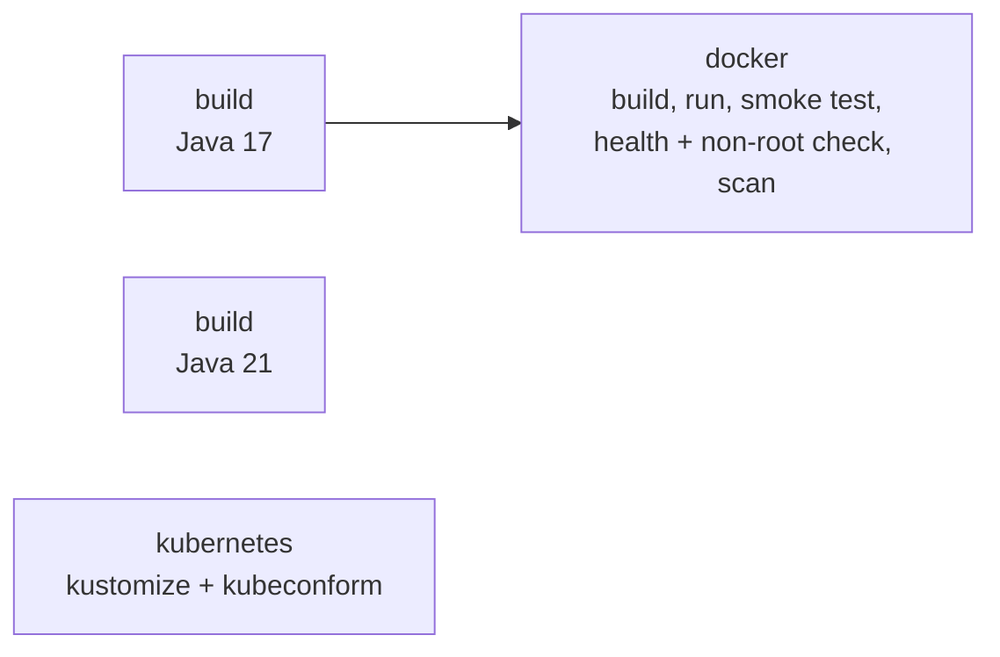

# 5. GitHub Actions: CI and releases

**Goal:** understand the two workflows, read their results, and publish a release with a Docker image.
**Time:** 30 minutes. **Needs:** only this GitHub repo.

## `ci.yml` - runs on every push to `master` and every pull request



| Job | What it proves |
|---|---|
| `build` (matrix 17, 21) | Code compiles and all tests pass on both LTS JDKs; coverage gate holds |
| `docker` | The multi-stage image builds, starts, passes the smoke test, turns `healthy`, runs as UID 10001 |
| `kubernetes` | `k8s/overlays/dev` and `prod` render and match the Kubernetes API schemas |

Things worth noticing in the file:

* **`concurrency` + `cancel-in-progress`** - pushing again cancels the outdated run.
* **`paths-ignore`** - editing only docs does not burn CI minutes.
* **`cache: maven`** in `setup-java` - caches `~/.m2` keyed on your POMs.
* **`cache-from/cache-to: type=gha`** - Docker layer cache stored in GitHub.
* **`$GITHUB_STEP_SUMMARY`** - the coverage table appears on the run's summary page.
* **`permissions: contents: read`** - least privilege for the `GITHUB_TOKEN`.

### Try it

1. Open a PR that changes `Language.java` - watch the checks appear on the PR.
2. Open **Actions → CI → the run**: summary shows the coverage table; **Artifacts** has `reports`
   (Surefire + JaCoCo HTML) and `webapp-war`.
3. Protect `master`: **Settings → Branches → Add rule** → *Require status checks to pass* →
   select `Build & test (Java 17)`, `Docker build & smoke test`, `Validate Kubernetes manifests`.
   Now nobody can merge a red PR.

## `release.yml` - runs when you push a version tag

```bash
git checkout master && git pull
git tag v1.0.0
git push origin v1.0.0
```

The workflow:

1. Builds and tests with Maven.
2. Logs in to `ghcr.io` with the built-in `GITHUB_TOKEN` (no secrets to create).
3. `docker/metadata-action` turns `v1.0.0` into tags `1.0.0`, `1.0` and `latest`.
4. Builds with `AzureDockerfile` (reusing the tested WAR) and pushes.
5. Creates a GitHub Release with auto-generated notes and `webapp.war` attached.

Run the published image anywhere:

```bash
docker run --rm -p 8080:8080 ghcr.io/ahmedeltofany/devopsappcicd:1.0.0
```

> The first time, the package is private. Make it public under
> **Your profile → Packages → devopsappcicd → Package settings**, or `docker login ghcr.io` first.

## Dependabot

`.github/dependabot.yml` checks Maven dependencies, GitHub Actions and Docker base images weekly and
opens PRs. CI tests each one, so upgrading becomes "review and merge".

## Exercises

1. Add `workflow_dispatch` inputs to `release.yml` so you can release without a tag.
2. Add a `deploy` job to `ci.yml` that deploys to Azure with `azure/login` (OIDC) and
   `azure/webapps-deploy`, gated by a GitHub **environment** with required reviewers.
3. Make the Trivy scan fail the build on `CRITICAL` findings (`--exit-code 1`). What breaks first?

Next: [6. Jenkins pipeline](06-jenkins.md)
